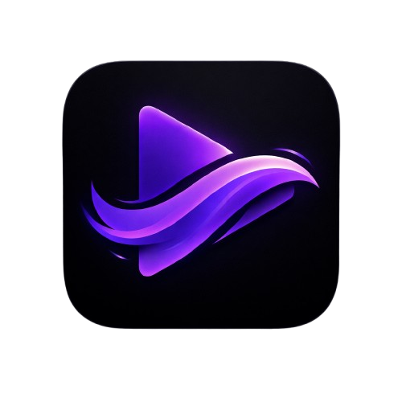
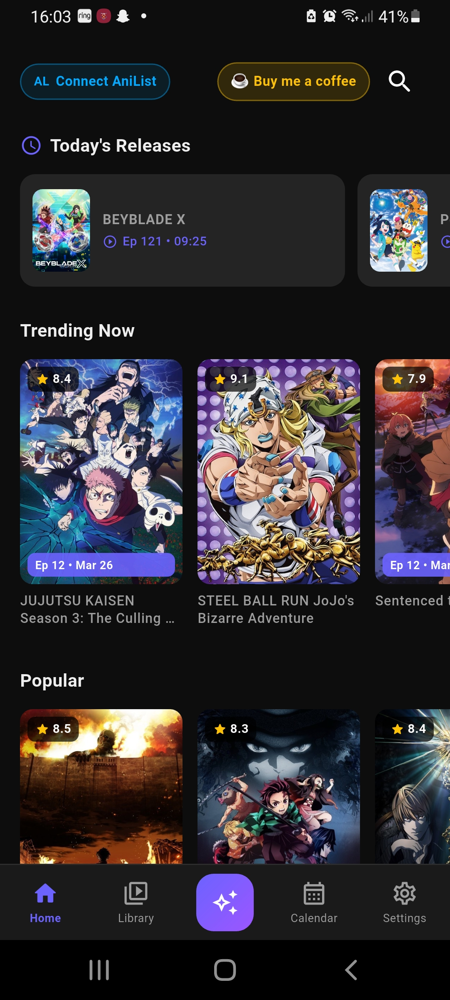
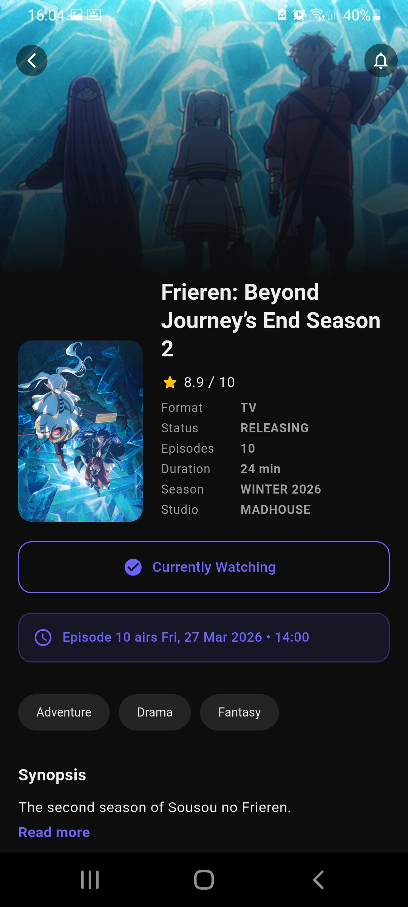
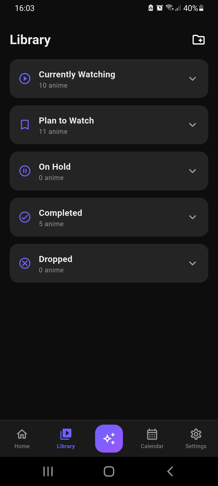
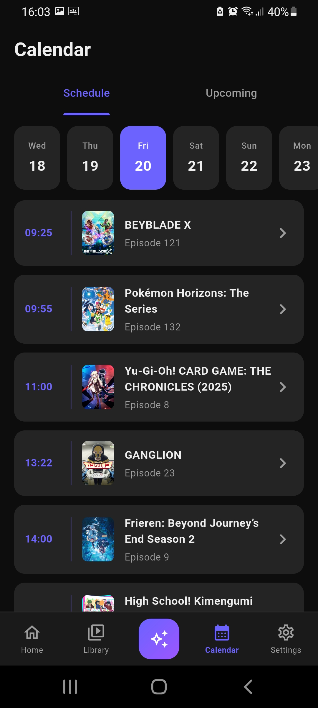
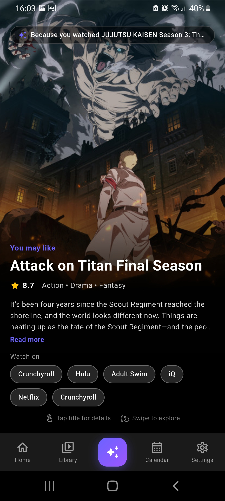

<h1>
  
  AniFlow — Anime Tracking Mobile App & Interactive Companion
</h1>


> **Project Status & Repository Note:** AniFlow was launched on the Google Play Store in 2026, reaching **100+ downloads** within its first few weeks of release (the store listing has since been sunsetted). This repository serves as a public architectural overview and technical case study; the production codebase, Firebase keys, and custom Rive animation assets are kept in a private repository.

---

## Overview

**AniFlow** is a full-stack mobile application built with **Flutter** and **Firebase** designed to track anime watch progress, recommend titles, and record watch history. 

Beyond standard library tracking via the **AniList API**, AniFlow focused on user retention and personalization—combining a tailored *"For You"* discovery engine, timezone-aware airing schedules, deep linking, and **AniPets**, a gamified virtual companion system powered by interactive **Rive** vector animations.

---

## App Preview

| Home | Anime Page | Library | Calendar | For You |
| :---: | :---: | :---: | :---: | :---: |
|  |  |  |  |  |

---

## Key Features & Engineering Highlights

### 1. AniList Sync, Discovery & Library Management
* **Dual Authentication & OAuth (`auth_provider.dart`, `anilist_auth_provider.dart`):** Integrated Firebase Authentication alongside **AniList OAuth 2.0**, enabling seamless two-way synchronization of user watchlists and progress.
* **Personalised "For You" Feed (`foryou/`):** Built a tailored recommendation engine powered by the AniList GraphQL API (`anilist_service.dart`) and user watch history.
* **Timezone-Aware Airing Calendar (`calendar/`, `timezone_utils.dart`):** Tracks weekly episode releases and dynamically converts airing timestamps to the user's local timezone.
* **Custom Library & Folder Organization (`library/`):** Allows users to organize watch history and collections into custom folders via a responsive grid interface (`folder_grid_screen.dart`).

### 2. Gamified Progression — *AniPets*
* **Interactive Rive Vector Companions (`anipet_rive.dart`):** Features 5 distinct companion species (**Aquapuff**, **Flameling**, **Mechabit**, **Shadowbat**, and **Sproutail**) driven by real-time `.riv` animation state machines.
* **3-Stage Evolution Mechanics:** Companions evolve across **Baby**, **Teen**, and **Adult** forms as users log episodes and maintain watch streaks, complete with custom habitat backgrounds (`assets/backgrounds/`).
* **Persistent Floating Companion (`floating_pet.dart`):** An interactive overlay widget integrated into the main app scaffold (`main_scaffold.dart`) so companions react while users browse.

### 3. Production Infrastructure & Play Store Release
* **Cloud Firestore & Serverless Functions (`firestore_service.dart`, `functions/`):** Real-time cloud persistence for user preferences, custom folders, and AniPet progression, supported by Node.js Firebase Cloud Functions.
* **Push Notifications, Deep Links & Shareable Links (`notification_service.dart`):** Configured Firebase Cloud Messaging (FCM) for episode release alerts alongside Android deep linking and shareable anime links.
* **AdMob / Monetisation Service (`ad_service.dart`):** Modular ad lifecycle wrapper decoupled from core feature screens, packaged into signed Android release builds (`build.gradle.kts`) for Google Play distribution.

---

## Project Structure

AniFlow follows a **Feature-First** architecture inside `lib/`, isolating state management (`Provider`), screens, and widgets by domain while keeping external APIs and Firebase services decoupled:

```text
aniflow/
├── android/ & ios/             # Native mobile builds, manifests & Play Store signing configs
├── macos/, linux/ & windows/   # Cross-platform desktop runners
├── web/                        # Web manifest & PWA entry point
├── functions/                  # Firebase Cloud Functions (Node.js backend triggers)
│   ├── index.js
│   └── package.json
├── assets/
│   ├── animations/             # Rive (.riv) state-machine files (Baby/Teen/Adult)
│   │   ├── aquapuff/
│   │   ├── flameling/
│   │   ├── mechabit/
│   │   ├── shadowbat/
│   │   └── sproutail/
│   ├── backgrounds/            # Custom companion habitat artwork
│   ├── images/                 # App logos & branding assets
│   └── pets/                   # Static evolution sprites across all 15 forms
└── lib/
    ├── core/
    │   ├── constants/          # App-wide constants & API configurations
    │   ├── theme/              # Centralized styling & colour palette (app_theme.dart)
    │   ├── utils/              # Timezone conversion utilities (timezone_utils.dart)
    │   └── widgets/            # Reusable UI components (anime_card.dart)
    ├── features/
    │   ├── anime/              # Anime detail views, metadata & progress logging
    │   ├── anipets/            # Companion progression logic, Rive renderer & floating pet
    │   ├── auth/               # Login, registration, password reset & AniList OAuth
    │   ├── calendar/           # Weekly airing schedule & local timezone filtering
    │   ├── foryou/             # Personalised "For You" recommendation feed
    │   ├── home/               # Main dashboard & trending discovery
    │   ├── library/            # Watch history, lists & custom folder grids
    │   ├── notifications/      # In-app episode alert center
    │   ├── settings/           # Account, notification & app preferences
    │   └── splash/             # Startup & session hydration screen
    ├── navigation/
    │   ├── app_router.dart       # Centralized routing & deep-link handling
    │   └── main_scaffold.dart    # Persistent bottom navigation & floating pet host
    ├── services/
    │   ├── ad_service.dart               # Ad lifecycle wrapper
    │   ├── anilist_auth_service.dart     # AniList OAuth token exchange & storage
    │   ├── anilist_service.dart          # GraphQL queries & mutations
    │   ├── firestore_service.dart        # Cloud Firestore read/write operations
    │   └── notification_service.dart     # Push & local notification scheduling
    ├── firebase_options.dart   # Multi-platform Firebase configuration
    └── main.dart               # Application entry point & global Provider tree
```

---

## Tech Stack

| Layer | Technology |
| :--- | :--- |
| **Framework & Language** | Flutter & Dart |
| **State Management** | Provider Pattern (Feature-scoped `ChangeNotifier` providers) |
| **External API** | AniList GraphQL API & OAuth 2.0 |
| **Backend & Database** | Firebase Authentication, Cloud Firestore, Cloud Functions (Node.js) |
| **Interactive Animations** | Rive (`.riv` real-time vector state machines) |
| **Notifications & Linking** | Firebase Cloud Messaging (FCM), Local Notifications & Deep Links |
| **Distribution** | Google Play Console (Signed Android App Bundles) |

---

## Key Outcomes

* **Production Launch:** Successfully built, signed, and deployed to the Google Play Store, organically reaching **100+ downloads** within the first few weeks.
* **End-to-End Architecture:** Engineered the full stack from GraphQL data fetching and OAuth token persistence to serverless Firebase triggers and custom vector animations.
